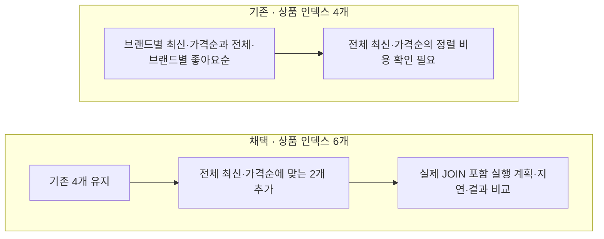

# 전체 최신순·가격순 인덱스 구성

[← 전체 선택 현황](total_trade_off.md)

## 판단할 문제

현재 상품 목록은 브랜드 필터 유무와 정렬 3종을 조합한다. 공통 조건은 상품·브랜드의 미삭제 상태다.
기존 브랜드별 최신순·가격순 인덱스는 `deleted, brand_id` 뒤에 정렬 열이 있다.
브랜드를 지정하지 않으면 `brand_id`가 고정되지 않으므로 전체 생성 시각·가격 순서를 직접 제공하지 못한다.

> **채택 — 기존 4개를 유지하고 전체 최신순·가격순 인덱스 2개 추가**
>
> 사용자가 2026-10-16 이 구성을 선택했다. 최신순은 `(deleted, created_at DESC, id DESC)`,
> 가격순은 `(deleted, price ASC, id DESC)`이며, 기존 동점 기준과 가격순의 혼합 방향을 유지한다.

## 흐름 비교



## 장단점 비교

| 기준 | 기존 4개 유지 | **기존 4개 + 전체용 2개** | 브랜드별 인덱스를 전체용으로 교체 |
|---|---|---|---|
| 전체 최신·가격순 | 전용 정렬 경로 없음 | 전용 경로 제공 가능 | 전용 경로 제공 가능 |
| 브랜드별 조회 | 현재 경로 유지 | 현재 경로 유지 | 브랜드 조건을 좁히는 정렬 경로가 달라짐 |
| 비용 | 추가 유지 비용 없음 | 인덱스 공간·생성/수정 유지 비용 증가 | 실제 영향 재설계 필요 |
| 결정 | 미채택 | **채택** | 미채택 |

## 적용 예정 SQL과 판단 한계

아래는 후속 적용할 DDL이며 현재 실행한 SQL이 아니다.

```sql
CREATE INDEX idx_products_deleted_created
    ON products (deleted, created_at DESC, id DESC);

CREATE INDEX idx_products_deleted_price
    ON products (deleted, price ASC, id DESC);
```

실제 옵티마이저 선택은 JOIN 순서·통계·조회 열·데이터 분포의 영향을 받는다.
정렬 인덱스가 있어도 브랜드 노출 조건에 의해 후보가 제외될 수 있고, COUNT 비용도 별도로 남는다.
응답 전체를 covering하려고 이름·설명·재고 등까지 추가하는 안은 이번에 선택하지 않았다.

근거는 현재 QueryDSL·엔티티 선언과 [MySQL ORDER BY 최적화](https://dev.mysql.com/doc/refman/8.0/en/order-by-optimization.html),
[복합 인덱스](https://dev.mysql.com/doc/refman/8.0/en/multiple-column-indexes.html)다. 성능 효과는 실측 후 평가한다.
