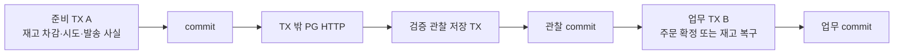
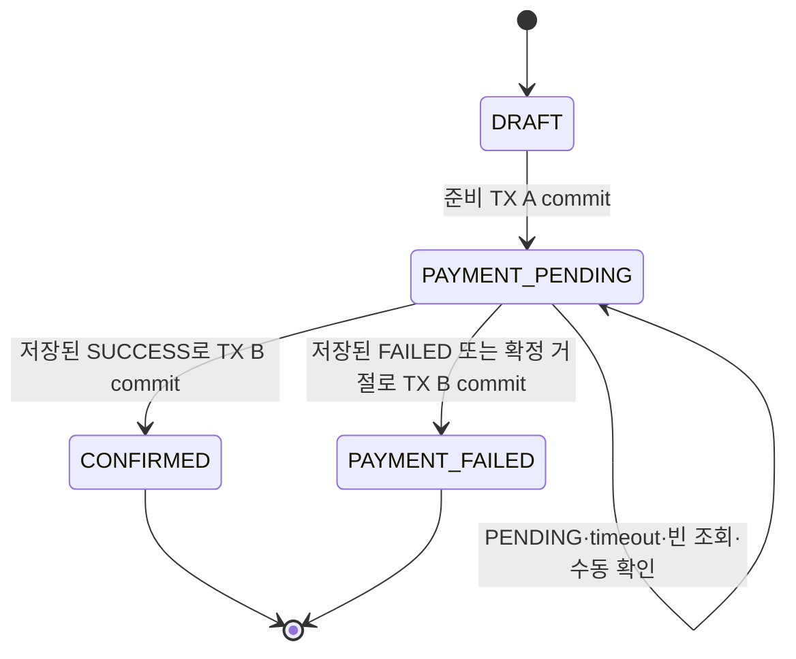
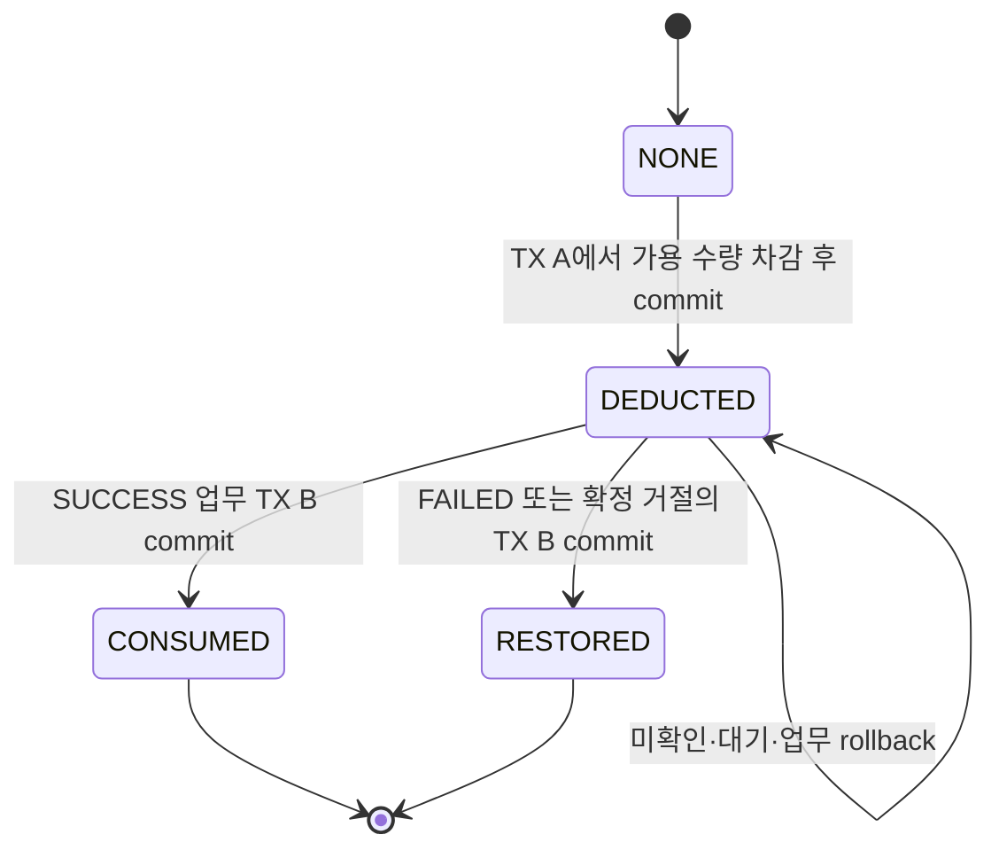
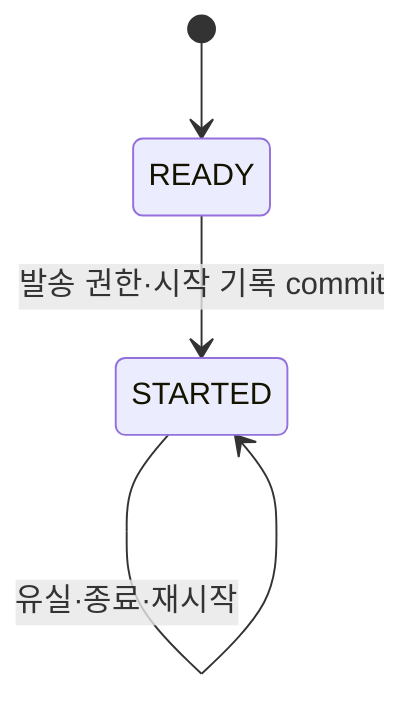
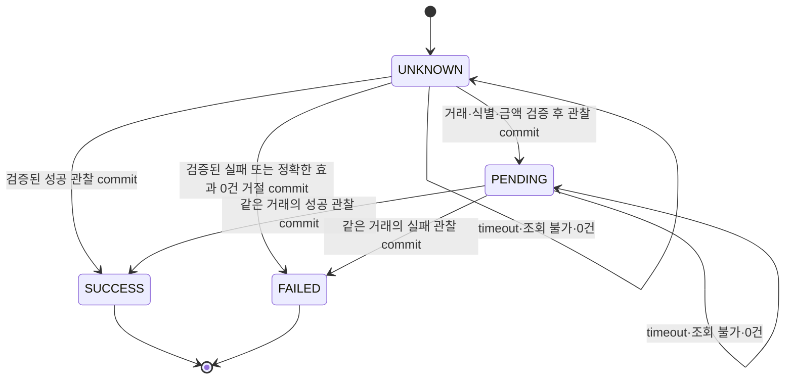
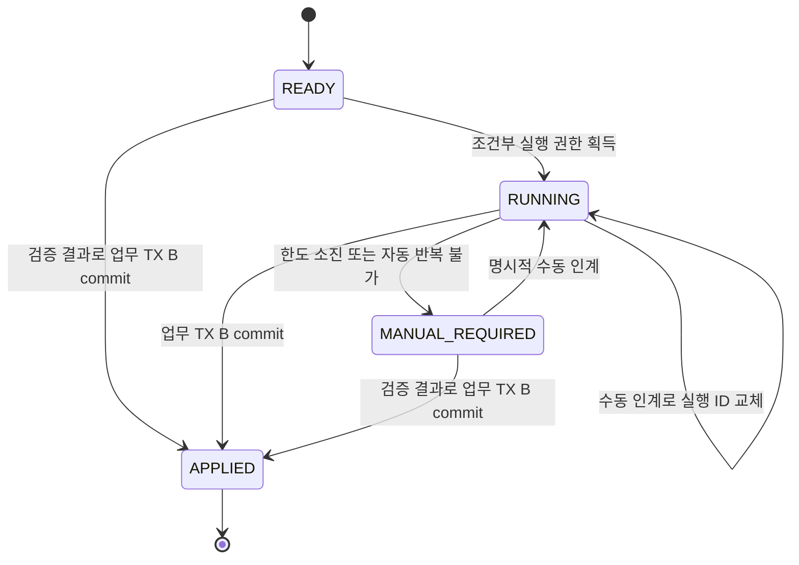
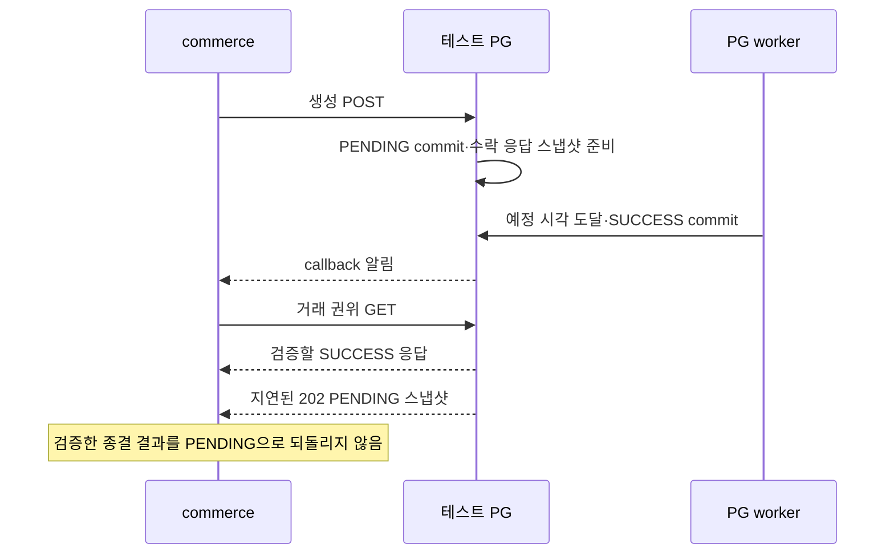

# 주문·재고·결제 상태 전이

[요구사항](requirement.md) · [구현 계획](plan.md) · [최소 보완](trade_off/10-learning-scope-completion.md)

상태: **설계 문서·기능 구현 전**. 현재 OrderStatus는 DRAFT/CONFIRMED다. 신규 상태/모델은 구현할 계약이며 실제 주문·재고 업무 연결은 R02의 목표 흐름이다.

## 1. 상태를 확정하는 트랜잭션

- TX A가 실패하면 주문·시도·차감 기록과 실제 재고 변경을 함께 rollback한다. HTTP 호출·대기는 TX 밖이다.
- 검증한 결과는 기존 pay 시도에 먼저 commit한다. TX B의 실패가 관찰을 지우지 않는다.
- TX B는 주문·실제 재고·처리 기록·관련 시도/작업 진행의 업무 효과를 함께 commit/rollback한다.
- 관찰 저장 전에 종료되거나 commit 여부가 불명확하면 저장 상태를 확인한다. 근거가 없으면 미확인을 유지하고 create 재발송·임의 실패/복구를 하지 않는다.

## 2. 주문 · R02 목표

| 상태 | 의미 |
|---|---|
| DRAFT | 아직 PG 결제를 시작하지 않음. 준비 TX rollback이면 유지 |
| PAYMENT_PENDING | 재고를 먼저 차감하고 내부 결제를 시작함. PG PENDING을 확인했다는 뜻까지 포함하지는 않음 |
| CONFIRMED | PG SUCCESS 저장과 별개로 주문 확정 TX B가 commit됨 |
| PAYMENT_FAILED | 검증된 실패/정확한 생성 전 거절에 따라 재고 복구까지 TX B가 commit됨 |

현재 코드에는 PAYMENT_PENDING/PAYMENT_FAILED가 없다. R01에서는 기존 POINT confirm을 유지하며 실제 주문 상태 연결은 R02다.
조회 오류·0건·한도 소진·수동 인계만으로 주문을 실패시키지 않는다. 실패 후 두 번째 결제 시도·환불·취소는 이번 범위 밖이다.

## 3. 재고 · 가용 수량과 mall 처리 기록

NONE은 기록 부재를 설명하는 표기이며 실제 enum이 아니다. 나머지는 mall 기록의 상태이며 상품 가용 재고 숫자와 구분한다.

| 사건 | 가용 재고 | 기록 |
|---|---|---|
| 5개 중 2개 주문, TX A commit | 5 → 3 | DEDUCTED, 수량 2 고정 |
| 성공 반영 | 3 유지 | CONSUMED, 추가 차감 없음 |
| 확정 실패 반영 | 3 → 5 | RESTORED |
| 같은 실패 반복 | 5 유지 | RESTORED, 추가 증가 없음 |
| PENDING/timeout/조회 불가 | 3 유지 | DEDUCTED |
| 재고 복구 TX 실패 | 증가 rollback | DEDUCTED, 검증 실패 사실은 별도 보존 |

- 성공 시 차감 상태 유지는 가용 수량을 다시 줄이지 않는다는 뜻이다. CONSUMED는 업무 반영 완료를 표시한다.
- 차감 뒤 관리자가 가용 수량을 10으로 설정하고 실패하면 2를 더해 12가 된다. 과거 값 5로 덮어쓰지 않는다.
- 삭제된 상품의 복구는 삭제 상태를 되살리지 않는다. 증가와 복구 완료 기록은 같은 TX B에 둔다.
- R01은 기록·수량·전이·저장 기반을 구현한다. 실제 상품 증감과 캐시 연결은 R02에서 검증한다.

## 4. 결제 · 세 가지 사실을 분리

### 발송 사실

STARTED는 실제 전송/수락의 증거가 아니다. 기록 직후 HTTP 전에 종료될 수도 있다.
그래도 READY로 되돌려 create를 다시 보내지 않는다. 같은 주문에 새 UUID를 보내도 두 번째 시도를 만들지 않는다.

### 마지막으로 검증한 PG 결과

UNKNOWN은 우리 서비스에 검증한 사실이 없다는 뜻이다. 외부 PG 상태는 PENDING/SUCCESS/FAILED다.
FAILED는 PG 거래 실패와 거래 없는 REJECTED_NO_EFFECT 사유를 구분한다. 후자는 정확한 422·code·boolean false·일치하는 주문/금액이 모두 필요하며 transactionKey는 없다.

| 기존 사실 + 새 관찰 | 처리 |
|---|---|
| 거래 존재 미확인 + 정확한 생성 전 거절 | 거절 근거 저장. 없는 거래 키 생성 금지 |
| PENDING(K) + 효과 0건 거절 | 존재/부재 모순. K·기존 결과 유지, 충돌 보존 |
| NO_EFFECT + SUCCESS(K) | 거절을 덮거나 K를 결합하지 않고 충돌 보존 |
| 같은 NO_EFFECT 반복 | 멱등 처리. 추가 create/업무 효과 없음 |
| SUCCESS(K) + 오래된 PENDING(K) | 종결 결과 유지, 회귀 없음 |
| SUCCESS(K) + FAILED(K) | 종결 충돌 보존, 기존 결과 유지 |
| 다른 주문/금액/계정/거래 키 | 검증 결과로 적용하지 않음 |

### 복구 작업의 진행

- APPLIED는 PG 결과 수신이 아니라 주문·재고 업무 반영 완료다. callback도 공통 업무 경계를 통해 완료할 수 있다.
- 최초 조회+추가 3회는 R03 정상 실행 정책이다. 조회 직전 회차를 commit하며 실제 HTTP 전에 종료돼도 사용 회차는 유지한다.
- 중단 RUNNING을 재시작 시 자동 재개하지 않는다. 담당자 수동 요청이 현재 실행 ID·상태를 조건으로 새 ID를 기록한다.
- 옛 실행은 새 진행/회차를 갱신하지 못하고 일반 save도 이를 우회하지 못한다. 이미 발송한 GET이 취소됐다고 가정하지 않는다.
- commerce 지터/다음 예약 정보는 저장하지 않는다. PG의 완료 예정 시각은 별도 사실로 보존한다.

## 5. 결과 저장과 업무 완료를 함께 읽기

| 상황 | 주문 | PG 결과 / 복구 진행 | mall 기록 |
|---|---|---|---|
| TX A commit, PG 응답 전 | PAYMENT_PENDING | UNKNOWN / 미반영 | DEDUCTED |
| PENDING 확인 | PAYMENT_PENDING | PENDING / 진행 중 | DEDUCTED |
| SUCCESS 저장, 주문 TX 실패 | PAYMENT_PENDING | SUCCESS / 미반영 또는 수동 필요 | DEDUCTED |
| 성공 업무 commit | CONFIRMED | SUCCESS / APPLIED | CONSUMED |
| 확정 거절 저장, 복구 TX 실패 | PAYMENT_PENDING | FAILED(NO_EFFECT) / 미반영 | DEDUCTED |
| 저장된 거절 재적용 commit | PAYMENT_FAILED | FAILED(NO_EFFECT) / APPLIED | RESTORED |
| 조회 소진·장애 중단 | PAYMENT_PENDING | 마지막 검증 결과 유지 / 확인 필요 | DEDUCTED |

'진행 중/미반영/확인 필요'는 상황 설명이다. 중단 RUNNING이 자동으로 MANUAL_REQUIRED로 바뀐다는 뜻은 아니며 담당자가 목록에서 찾아 인계한다.
저장된 신뢰할 종결 결과는 재적용할 수 있다. 특히 거래 없는 거절은 빈 목록으로 다시 증명하지 않는다. 근거 없는 빈 조회만으로 실패를 확정하지 않는다.

### PENDING 응답보다 SUCCESS를 먼저 관찰할 수 있음

callback 본문은 알림이며 권위 조회 없이 성공으로 믿지 않는다. callback 발행/전달 유실도 허용하고 기존 거래 조회로 확인한다.
R01은 PG 직접 POST/GET와 adapter로 검증한다. commerce confirm의 PG 전환과 실제 주문·재고 상태 보호는 R02에서 연결한다.
